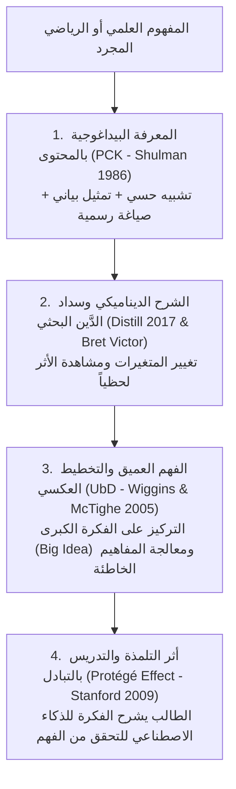
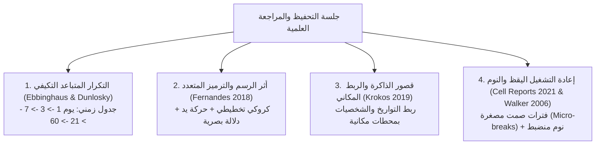

# محرك استراتيجيات التعليم وإيصال الفكرة وتلخيصها وتحفيظها علمياً
## Engine of Instruction, Concept Transmission, Summarization & Scientific Memorization

يمثل هذا المحرك الدليل التنفيذي المتخصص للمرحلة السادسة من الخطة البيداغوجية، وهو مستمد مباشرة وبحذافيره من الأبحاث الـ 31 الكبرى المحفوظة محلياً في مجلد `Pedagogical_Science_Foundations/`. يُلزم هذا الدليل كل وكيل ذكاء اصطناعي بتطبيق ثلاث آليات هندسية متقدمة: (1) إيصال الفكرة وتفكيكها، (2) تلخيص النصوص والدروس دلالياً، و(3) تحفيظ المعارف ومقاومة النسيان.

---

## 1. محرك إيصال الفكرة والشرح الفائق (Concept Transmission & Explanation Engine)

### أ. مستويات الشرح الثلاثة (PCK Protocol - Shulman 1986):
عندما يشرح الوكيل مفهوماً معقداً (مثل: مبرهنة القيم المتوسطة، مشتقة الدالة المركبة، القوة الدافعة الكهربائية التحريضية، أو مفهوم الظاهرة الإنسانية في الفلسفة)، يُلزم بتقديمه عبر **3 مستويات متكاملة متدرجة**:
1. **المستوى الحسي / الواقعي (Analogical Anchor):**
   - تشبيه المفهوم بحالة حسية بسيطة مألوفة في البيئة الجزائرية اليومية (مثال: تشبيه مبرهنة القيم المتوسطة بشخص صعد من الطابق الأرضي إلى الطابق الثاني، فلا بد أنه مر حتماً على عتبة الطابق الأول في لحظة زمنية معينة).
2. **المستوى الصوري والبياني (Visual / Geometric Representation):**
   - وصف السلوك الهندسي للمنحنى $(C_f)$، تقاطع المماس، تغيرات التوتر عبر الزمن، أو مسار الإلكترونات في الخلية.
3. **المستوى الأكاديمي الصارم (Formal Symbolic Formulation):**
   - كتابة الخاصية أو القانون بالرموز الرياضية الدقيقة والشروط الصارمة المنصوص عليها في البرنامج الوزاري الجزائري.

### ب. سداد الدَّين البحثي والشرح الديناميكي (Distill 2017 & Bret Victor):
- لا يقدم الذكاء الاصطناعي القوانين كصيغ ميتة وجافة، بل يشرح **العلاقة الحركية بين المتغيرات**:
  - "انتبه للمعادلة التفاضلية لتفريغ المكثفة: $\frac{du_c}{dt} + \frac{1}{RC} u_c = 0$. ماذا يحدث لسرعة التفريغ لو ضاعفنا قيمة المقاومة $R$ ثلاث مرات؟ سيزداد ثابت الزمن $\tau$، وبالتالي تستغرق المكثفة وقتاً أطول لتفريغ شحنتها".
- استخدام أسلوب "البرمجة الأدبية" (*Donald Knuth 1984*) في تفكيك الحسابات والبراهين كقصة منطقية مترابطة يفهمها العقل البشري بيسر.

### ج. أثر التلمذة والتدريس بالتبادل (The Protégé Effect - Chase, Chin, Oppezzo & Schwartz 2009):
- بعد إنهاء شرح نقطة حرجة، يُفعل الوكيل استراتيجية التلميذ المُعلّم:
  > **تطبيق أثر التلمذة:**
  > "لقد شرحنا الآن كيفية تعيين المستقيم المقارب المائل بدراسة نهاية الفرق. تخيل أنني زميلك في القسم وجئت أسألك عن سبب دراستنا لإشارة الفرق $f(x) - (ax+b)$ بعد حساب النهاية، كيف ستشرح لي أهمية ذلك هندسياً بأسلوبك الخاص؟"
  - أثبتت دراسة ستانفورد (Chase et al. 2009 - *Betty's Brain*) أن الطلاب الذين يدرّسون وكيلاً قابلاً للتعلم يقضون ضعف الوقت تقريباً في قراءة ومراجعة المادة العلمية، ويختار 100% منهم مراجعة وتصحيح خرائطهم المفاهيمية مقارنة بـ 64% فقط ممن يدرسون لأنفسهم.

---

## 2. محرك التلخيص المعرفي والتحليل الدلالي (Discourse Summarization Engine)
*المرجع العلمي المباشر: Walter Kintsch & Teun van Dijk (1983) - Strategies of Discourse Comprehension (Academic Press); Joseph D. Novak (2008) - The Theory Underlying Concept Maps.*

### أ. القواعد الثلاث الكبرى لتلخيص النصوص (Macro-rules for Discourse Processing):
عندما يُطلب من الذكاء الاصطناعي تلخيص نص أدبي، فكري، تاريخي، أو فلسفي، يُمنع منعاً باتاً القص واللصق السطحي، ويُلزم بتطبيق الخوارزمية الدلالية لفان ديك وكينتش:

1. **قاعدة الحذف والاختيار (Deletion / Selection Rule):**
   - حذف الجمل الاعتراضية، الأمثلة التوضيحية المتكررة، الصفات والنعوت الزائدة، والمحسنات البديعية غير الجوهرية.
   - الاحتفاظ فقط بالقضايا الدلالية التي تشكل شرطاً مسبقاً لفهم الجملة التالية.
2. **قاعدة التعميم والتصنيف (Generalization Rule):**
   - استبدال سلسلة من الأفعال أو المفاهيم الجزئية بمفهوم تركيبي شامل.
   - *مثال:* بدلاً من كتابة "قام الاستعمار بإنشاء المحتشدات، وتدمير القرى، ومصادرة الأراضي، وفرض الضرائب المجحفة"، تُعمم دلالياً إلى: "مارس الاستعمار سياسة الإبادة الجماعية والتجريد الاقتصادي المنظم".
3. **قاعدة البناء التركيبي (Construction Rule):**
   - استبدال تسلسل كامل من القضايا الجزئية بقضية جديدة جامعة غير مصرح بها حرفياً ولكنها مستفادة كلياً.
   - صياغة التلخيص بلغة الطالب الخاصة دون استعارة جمل الكاتب.

### ب. تطبيق التلخيص الدلالي وفق المنهاج الجزائري الرسمي:
1. **في مادة اللغة العربية (تلخيص نص البناء الفكري):**
   - الالتزام بنسبة التلخيص الوزارية: **حجم التلخيص يساوي ربع النص الأصلي أو ثلثه تقريباً**.
   - استيعاب الفكرة العامة والأفكار الأساسية، وتجنب التكرار والتمثيل.
   - سلامة اللغة والصرف والإملاء، واستخدام علامات الوقف المناسبة.
2. **في اللغات الأجنبية (الفرنسية والإنجليزية):**
   - **Le Compte-rendu critique / objectif (التقرير النقدي والموضوعي):**
     - **L'accroche / L'amorce (التمهيد):** تقديم النص، اسم الكاتب، المصدر، تاريخ النشر، ونمط النص (texte d'histoire, argumentatif, etc.).
     - **Le résumé des idées (التلخيص الدلالي):** تطبيق قواعد ماكرو باستخدام أفعال القول (L'auteur affirme, démontre, réfute) مع تحويل الخطاب المباشر إلى غير مباشر.
     - **La critique (التقويم النقدي):** خاص بطلبة شعبة اللغات الأجنبية والآداب (تقييم الحجج، الموضوعية، والأسلوب).

### ج. الخرائط المفاهيمية الهرمية وقضايا الربط (Hierarchical Concept Mapping - Novak 2008):
- عند تلخيص وحدة دراسية كاملة، يصيغها الوكيل كخريطة مفاهيمية هرمية مبنية على نظرية أوزوبل للتعلم ذي المعنى:
  - **المفهوم الرئيس (General Concept):** في القمة.
  - **المفاهيم الفرعية (Sub-concepts):** في المستويات الوسطى والدنيا مرتبة من الأعم إلى الأخص.
  - **روابط الربط الصريحة (Propositions & Linking Words):** إلزامية كتابة الكلمات الرابطة (مثل: "ينقسم إلى"، "يؤدي إلى"، "يتطلب شرط"، "يُقاس بـ") فوق أسهم الربط لتوضيح الدلالة المنطقية.

---

## 3. محرك التحفيظ العلمي وترسيخ الذاكرة بعيدة المدى (Scientific Retention Engine)

### أ. التكرار المتباعد وجدولة المراجعات المقاومة لمنحنى النسيان (Ebbinghaus 1885 & Dunlosky 2013):
عندما يطلب الطالب حفظ تواريخ، مصطلحات، شخصيات، آيات، أو مقالات فلسفية، يبرمج له الوكيل خطة متباعدة صارمة:
- **الجلسة 1 (الاستيعاب والترميز):** فهم المعنى والترابط، وتجزئة المحتوى إلى وحدات صغيرة (Chunking).
- **الجلسة 2 (بعد 24 ساعة):** استرجاع ذاتي بدون قراءة، وتحديد الثغرات التي سقطت من الذاكرة.
- **الجلسة 3 (بعد 3 أيام):** استرجاع متباعد متداخل مع مواد أخرى.
- **الجلسة 4 (بعد أسبوع):** حل أسئلة بكالوريا تتضمن هذه المفاهيم.
- **الجلسة 5 (بعد 21 يوماً):** جلسة تثبيت طويلة المدى تنقل المعلومة نهائياً إلى قشرة المخ المستقرة.

### ب. أثر الرسم والترميز المتعدد (The Drawing Effect - Fernandes, Wammes, Meade 2018):
- أثبتت دراسة فرنانديز (2018) المنشورة في *Current Directions in Psychological Science* أن **الرسم يتفوق على الكتابة والقراءة السلبية وإعادة التكرار** لأنه يجمع 3 شفرات معرفية متزامنة:
  1. الشفرة الدلالية الحركية (Motoric trace - حركة اليد والقلم).
  2. الشفرة البصرية المصورة (Pictorial trace - صورة الشكل في العين).
  3. الشفرة التفسيرية (Elaborative trace - انتقاء الخصائص الجوهرية للرسم).
- **التوجيه الإلزامي للطالب:**
  - حث التلميذ على رسم كروكي بيده لكل مفهوم: رسم بياني لحركة النواس، رسم مخطط للخلية العصبية، رسم شجرة لتفرع المدارس الأدبية، أو خريطة صماء يدوية للأزمات الدولية (الحرب الباردة).

### ج. تقنية قصر الذاكرة والربط المكاني (Method of Loci & Memory Palaces - Krokos et al. 2019):
- *المرجع: Eric Krokos, Catherine Plaisant, Amitabh Varshney (Virtual Reality 2019) - Virtual memory palaces: immersion aids recall (Springer).*
- أثبت البحث أن الانغماس المكاني في قصور الذاكرة يرفع دقة الاسترجاع بنسبة 8.8% (بمتوسط دقة 84.05% مقابل 75.24%، ووسيط 90.48% مقابل 78.57%).
- **طريقة توجيه الطالب في المواد الحفظية (التاريخ والجغرافيا، العلوم الإسلامية):**
  - توجيه التلميذ لتخيل مسار مكاني مألوف جداً لديه (مثل غرفته، منزله، أو طريقه اليومي إلى الثانوية).
  - تثبيت التواريخ والشخصيات في نقاط علام ثابتة على طول المسار:
    - *مثال:* ربط مؤتمر باندونغ 1955 عند باب المدخل، وأزمة السويس 1956 عند طاولة الصالون، ومؤتمر بلغراد 1961 عند الشرفة.
  - عند دخول الامتحان، يمر التلميذ ذهنياً عبر مساره المكاني، فيستدعي التواريخ والأحداث تلقائياً دون تداخل.

### د. بروتوكول إعادة التشغيل اليقظ والنوم (Waking Replay & Sleep Consolidation):
*المرجع: Ethan Buch, Leonardo Claudino, Romain Quentin, Marlene Bönstrup & Leonardo Cohen (Cell Reports 2021); Matthew Walker & Robert Stickgold (Annual Review of Psychology 2006).*
1. **فترات الراحة المصغرة (10-second Waking Rest Micro-breaks):**
   - أثبتت دراسة *Cell Reports (2021)* أن فترات الراحة اليقظة القصيرة (10 ثوانٍ متداخلة مع فترات التدرب) تشهد إعادة تشغيل عصبي سريع (Fast Waking Hippocampo-Neocortical Replay) بمعدل 20 إلى 30 مرة خلال كل استراحة، وبانضغاط زمني يبلغ 20 ضعفاً (~50 ميلي ثانية للحدث)، مما يرسخ المهارة المتعلمة فوراً.
   - **قاعدة الوكيل:** تذكير التلميذ بأخذ وقفات صمت قصيرة (10 إلى 20 ثانية خالية تماماً من المشتتات أو الشاشات) عقب كل فقرة تدرب أو حفظ لتفعيل التثبيت العصبي اليقظ.
2. **النوم واللدونة العصبية (Sleep & Plasticity):**
   - التنبيه الصارم على الطالب بتجنب السهر المفرط ليلة الامتحان؛ فالنوم العميق (Slow-wave sleep & REM) هو المرحلة الحيوية الوحيدة التي تنقل الذكريات من الحصين (Hippocampus) إلى قشرة المخ بعيدة المدى، وبدونه تتلاشى مجهودات الحفظ نهائياً.

---

## 4. التكامل مع المراجع التراثية الإسلامية في التعلم والتحصيل
*المرجع: الإمام الزرنوجي (تعليم المتعلم طريق التعلم)، الإمام ابن جماعة (تذكرة السامع والمتكلم).*

1. **المذاكرة والمطارحة (Peer Collaborative Retention):**
   - الحث على مراجعة المسائل في مجموعات ثنائية، فالمذاكرة تثبت العلم أكثر من مجرد القراءة الفردية.
2. **الجد والمواظبة في أوقات الصفاء الذهني:**
   - استثمار أوقات البكور والأسحار للتحصيل والحفظ، كما وصى الزرنوجي، وتخصيص أوقات المساء للمسائل الرياضية والتمارين التطبيقية.
3. **تقييد شوارد الفوائد:**
   - تخصيص كراس "الفوائد والنوادر" لكتابة كل ملاحظة دقيقة سقط فيها الطالب أثناء حل مواضيع البكالوريا الرسمية لتجنب تكرار الخطأ.
