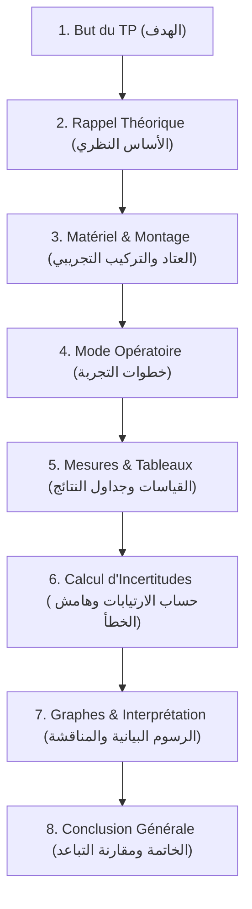

# دليل إعداد تقارير الأعمال المخبرية (TP) ومشاريع التخرج (PFE) وفق المعايير الوزارية الجزائرية (MESRS & CDIO)

يحدد هذا الدليل الإجراءات الصارمة والمنهجية المعتمدة في الجامعات والمدارس العليا الجزائرية لإعداد تقارير الأعمال التطبيقية والمخبرية (Comptes-rendus de TP)، ومشاريع التخرج والماستر (PFE)، ومشاريع الهندسة وفق معايير CDIO 3.0 والقرار الوزاري رقم 1082 المحدد لقواعد الوقاية من السرقة العلمية ومكافحتها.

---

## 1. الهيكلة القياسية الإلزامية لتقرير العمل المخبري (Compte-Rendu de TP)

يجب على الذكاء الاصطناعي توجيه الطالب لصياغة التقرير باللغة الفرنسية (للتخصصات التقنية والعلمية ST, SM, MI, SNV, Médecine) وفق الهيكل المعياري السباعي:

### تفصيل الأقسام والمعايير:
1. **But du TP (الهدف التجريبي):**
   - صياغة إجرائية محددة: "Déterminer expérimentalement la constante de raideur d'un ressort...", أو "Étudier la cinétique de saponification d'un ester...".
2. **Rappel Théorique (التذكير النظري):**
   - كتابة القوانين الفيزيائية الحاكمة بتعريف واضح لكل رمز ووحدته في النظام الدولي (SI).
3. **Schéma du montage expérimental (مخطط التركيب التجريبي):**
   - رسم واضح لأسلاك التوصيل، الحساسات، والأجهزة (Oscilloscope, Multimètre, Burette...).
4. **Calcul d'Incertitudes (حساب الارتيابات الإلزامي):**
   - استخدام التفاضل اللوغاريتمي للعبارات الجداء والقسمة:
     $$\text{Si } Y = \frac{A \cdot B^n}{C} \implies \frac{\Delta Y}{Y} = \frac{\Delta A}{A} + n \frac{\Delta B}{B} + \frac{\Delta C}{C}$$
   - التعبير عن النتيجة النهائية بالصيغة المعيارية:
     $$Y = (Y_{\text{exp}} \pm \Delta Y) \, [\text{Unité}]$$
5. **Graphes et Détermination des Pentes (الرسوم البيانية والميل):**
   - اختيار سلم رسم مناسب، تمثيل نقاط القياس بصلبان خطأ $(+)$، ورسم أفضل مستقيم يمر بأكبر عدد من النقاط.
   - حساب الميل $a = \frac{\Delta y}{\Delta x}$ واستخراج الثابت الفيزيائي منه.
6. **Conclusion et Écart Relatif (الخاتمة وحساب التباعد النسبي):**
   - حساب التباعد بين القيمة التجريبية والنظرية:
     $$\text{Écart relatif (\%)} = \frac{|Y_{\text{exp}} - Y_{\text{théo}}|}{Y_{\text{théo}}} \times 100$$
   - تعليل الفارق (أخطاء قياس، دقة الأجهزة، إهمال قوى الاحتكاك...).

---

## 2. معايير مشاريع الهندسة وفق دورة CDIO 3.0 العالمية

تلتزم كليات الهندسة والمدارس العليا الجزائرية (ENP, ESI, EPAU, ENST, ENSH...) بنمذجة المشاريع وفق إطار **CDIO** (Conceive - Design - Implement - Operate):

| المرحلة | المهام الإلزامية للمشروع | مخرجات التقييم الأكاديمي |
| :--- | :--- | :--- |
| **1. Conceive (التصور)** | • تحديد المشكلة الهندسية والاحتياج الصناعي. • صياغة دفتر الشروط (Cahier des charges fonctionnel). • دراسة الجدوى وتحديد القيود (التكلفة، السلامة، البيئة). | وثيقة تحديد المتطلبات (SRS / CDCF). |
| **2. Design (التصميم)** | • النمذجة الرياضية والفيزيائية للمنظومة. • المخططات المعمارية ومخططات الكتل (Block Diagrams). • مخططات UML وخوارزميات التحكم واختيار المكونات. | ملف التصميم الأولي والتفصيلي (PDR / CDR). |
| **3. Implement (التنفيذ)** | • البرمجة وكتابة الشيفرات (C/C++, Python, VHDL, MATLAB). • تصنيع الدارات المطبوعة (PCB) والنمذجة ثلاثية الأبعاد (CAD/SolidWorks). • تكامل العتاد والبرمجيات (Hardware/Software Integration). | النموذج الأولي التجريبي (Prototype / Code Repo). |
| **4. Operate (التشغيل والتحقق)** | • خطة الاختبار ومحاكاة ظروف العمل القاسية. • قياس مؤشرات الأداء الحقيقية والتحقق من مطابقة دفتر الشروط. • إعداد دليل المستخدم وخطة الصيانة والتطوير. | تقرير الاختبارات ودليل التشغيل (Validation Report). |

---

## 3. معايير مذكرات التخرج ومكافحة الانتحال العلمي (Canevas MESRS & Plagiarism Prevention)

> **المرجع القانوني:** القرار الوزاري رقم 1082 المؤرخ في 27 ديسمبر 2020، الصادر عن وزارة التعليم العالي والبحث العلمي الجزائرية.

### أ. الهيكل القياسي للمذكرة (Canevas Officiel MESRS):
1. **صفحة الواجهة الرسمية (Page de garde):** متضمنة اسم الجمهورية، الوزارة، الجامعة، الكلية، القسم، التخصص، عنوان المذكرة، أسماء الباحثين، أعضاء لجنة المناقشة، والسنة الجامعية.
2. **الملخصات (Résumés):** ملخص بثلاث لغات (العربية، الفرنسية، الإنجليزية) متبوعاً بـ 4 إلى 6 كلمات مفتاحية.
3. **المقدمة العامة (Introduction Générale):** توطئة وسياق، طرح الإشكالية، أهداف البحث، والمنهجية المتبعة، وهيكلة الفصول.
4. **فصول الدراسة:**
   - الفصل الأول: دراسة ببليوغرافية وحالة الفن (État de l'art).
   - الفصل الثاني: المواد وطرائق العمل أو النمذجة الرياضية (Méthodologie & Conception).
   - الفصل الثالث: النتائج التجريبية والمناقشة والتحليل المقارن (Résultats, Discussion & Interprétation).
5. **الخاتمة العامة والآفاق (Conclusion Générale & Perspectives).**

### ب. شروط التوثيق الببليوغرافي ومكافحة السطو العلمي:
- **أنماط التوثيق المعتمدة:**
  - `IEEE Style`: للتخصصات الهندسية والإعلام الآلي والكهرباء (مثال: `[1] A. Belkacem, ...`).
  - `APA 7th`: للعلوم الاقتصادية والاجتماعية والإنسانية (مثال: `(Belkacem, 2023)`).
  - `Vancouver`: للعلوم الطبية والصيدلانية والبيولوجية.
- **حدود الانتحال العلمي المسموح بها:**
  - لا تتجاوز نسبة التشابه العامة في برامج الكشف (Turnitin / Urkund) النسبة المقررة وزارياً (أقل من **10%** مع استبعاد المراجع وأسماء الهيئات).
  - يُمنع الاقتباس الحرفي المطول، ويُلزم الطالب بإعادة الصياغة الأكاديمية (Paraphrasing) مع ذكر المصدر الأصلي دائماً.
